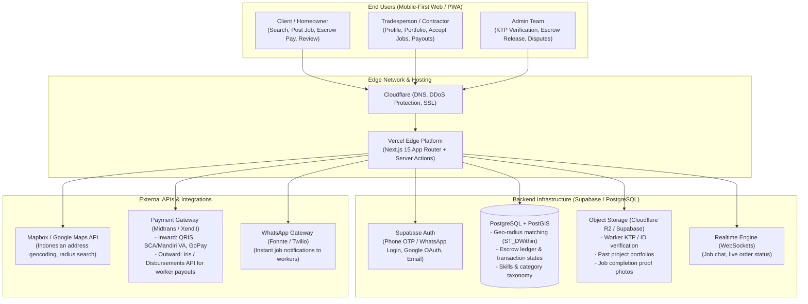
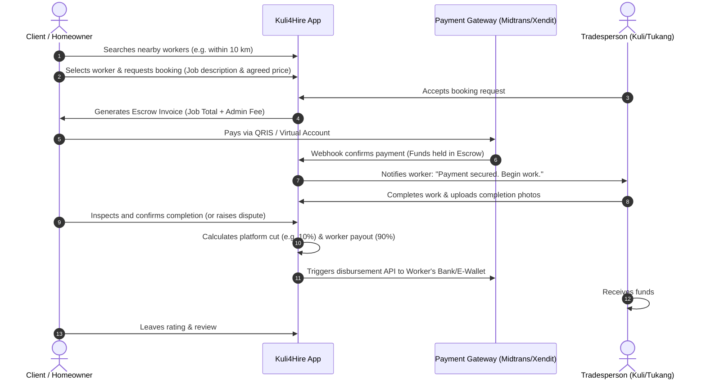

# Kuli4Hire Platform Architecture & Online Hosting Plan

Tailored architecture, hosting services, and technical blueprint for **Kuli4Hire** — an on-demand marketplace connecting clients with skilled tradespeople, construction workers, handymen, and builders in Indonesia/Southeast Asia.

---

## 1. System Architecture Diagram

---

## 2. Required Online Services & Cost Breakdown

To run Kuli4Hire fully online in production, here is the curated service stack:

| Service Layer | Provider | Free Tier / Dev Cost | Production / Scale Cost | Why This Provider? |
| :--- | :--- | :--- | :--- | :--- |
| **Domain & DNS** | Cloudflare + Registrar (Porkbun / Niagahoster) | Free DNS & SSL (~$10/yr domain) | ~$10/yr | Ultra-fast edge DNS in Jakarta/Singapore, DDoS defense, automatic SSL. |
| **Web Hosting** | **Vercel** (or Cloudflare Pages) | **Free** (Hobby plan) | $20/month (Pro when traffic scales) | First-class Next.js support, instant deployments, global CDN edge. |
| **Database & Auth** | **Supabase** (Managed PostgreSQL) | **Free** (500MB DB, 50k monthly active users) | $25/month (Pro) | Native **PostGIS** geospatial engine, role-based auth, storage, and real-time WebSockets without needing a separate backend server. |
| **File Storage** | **Cloudflare R2** / Supabase Storage | **Free** (10GB storage, $0 egress fees) | ~$0.015/GB | Stores worker KTPs (protected), portfolio images, and site photos. R2 has zero bandwidth egress fees. |
| **Maps & Geocoding** | **Mapbox** | **Free** (50,000 monthly map loads / geocodes) | Pay-as-you-go | Accurate Indonesian geocoding and lightweight map tiles. |
| **Payment Gateway & Escrow** | **Midtrans** or **Xendit** | Pay-as-you-go (No monthly fee) | ~1.5% - 2% + VAT per transaction; ~Rp 5,000 per bank disbursement | Standard for Indonesia (QRIS, Virtual Accounts BCA/Mandiri/BRI, E-Wallets). Supports automated disbursement APIs to pay workers upon job completion. |
| **Worker Notifications** | **Fonnte** or **Twilio** (WhatsApp API) | ~$5 - $10/month | ~$15 - $30/month | Indonesian tradespeople rarely check emails; instant WhatsApp messages for new job requests dramatically increase response rates. |

> **Summary**: You can launch and test the entire MVP online for **virtually $0 to ~$15/month** (just the domain name and a WhatsApp messaging credit) before scaling up paid plans.

---

## 3. Escrow & Commission Transaction Lifecycle

---

## 4. Database Schema Overview (PostgreSQL + PostGIS)

Key tables to be provisioned:
1. `profiles`: Basic user credentials (client, provider, admin), phone, avatar, verified status.
2. `provider_profiles`: Trade categories (e.g., *Tukang Bangunan*, *Tukang Cat*, *Tukang Las*, *Tukang Ledeng*, *Mandor*), daily/hourly rate, bio, experience years, `location` (`geography(POINT, 4326)`), coverage radius (km), KTP verification status.
3. `portfolios`: Project photos and descriptions of past work.
4. `bookings`: Client ID, Provider ID, address, coordinates, scheduled date, estimated days/hours, total price, status (`pending`, `accepted`, `escrow_funded`, `in_progress`, `completed`, `cancelled`, `disputed`).
5. `transactions`: Escrow payment reference, Midtrans/Xendit order ID, payment method, gross amount, platform commission (10-15%), net payout amount, disbursement status.
6. `reviews`: Rating (1-5), feedback, photo attachments, booking ID verification.

---

## 5. Implementation Roadmap

- **Step 1: Next.js + Tailwind + shadcn/ui Base Setup**
  - Scaffold Next.js 15 App Router workspace with TypeScript, Tailwind CSS, Lucide icons, and layout structure.
- **Step 2: Database & PostGIS Setup**
  - Initialize Supabase schema, configure PostGIS extension, define SQL migration for geo-queries and RLS policies.
- **Step 3: Geolocation Search & Discovery**
  - Build intuitive location picker and radius search for clients to find nearby workers by skill category and rating.
- **Step 4: Worker Profile Builder & Verification**
  - Multi-step onboarding for tradespeople: skill tags, pricing tiers (daily vs. hourly), portfolio gallery, and KTP upload.
- **Step 5: Booking & Escrow Flow**
  - Midtrans/Xendit checkout integration, payment status webhooks, and payout release logic.
- **Step 6: Reviews, Realtime Chat & WhatsApp Alerts**
  - In-app chat + WhatsApp notifications when a job request or payment arrives.
- **Step 7: Production Deployment**
  - Link GitHub repository to Vercel and set up Cloudflare DNS.
